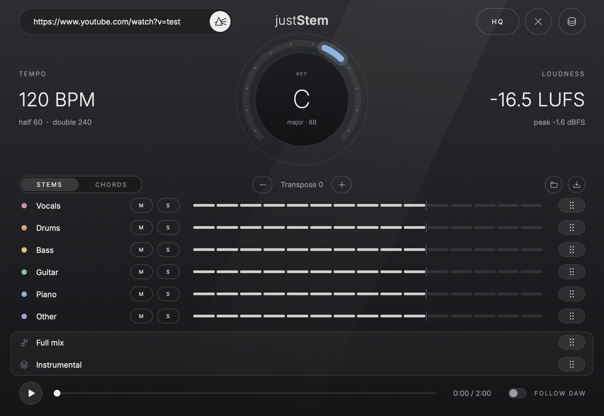
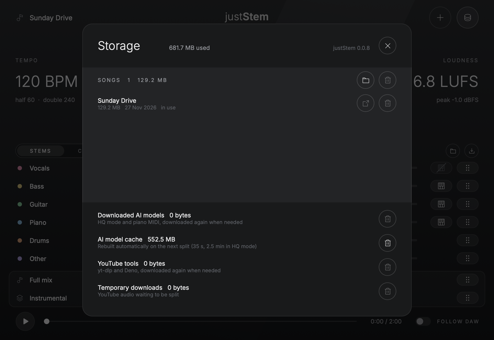

# justStem

A VST3 / AU plug-in for people who make covers. Give it a song (an audio file or a YouTube link)
and it splits it into **vocals, drums, bass, guitar, piano and other**, and finds the **key, tempo,
loudness and chords**. Everything runs on your computer.

<p align="center"></p>

## Features

- 6 stems plus an instrumental, as 24-bit WAVs you can drag onto DAW tracks
- Key (with Camelot code), tempo and loudness (LUFS)
- Chords bar by bar, with a copyable chart
- Transpose ±11 semitones: chords, live preview and pitch-shifted stem export
- Stem preview with mute / solo / volume, in sync with your DAW

| Start | Splitting | Chords |
|:---:|:---:|:---:|
|  |  |  |
| **New song** | **Storage** | **Stems** |
|  |  |  |

## Install

Download from [Releases](https://github.com/PLATONG34821/justStem/releases), unzip, and copy the
plug-in into this folder, then rescan plug-ins in your DAW:

| | File | Copy to |
|---|---|---|
| **macOS** | `justStem.vst3` | `~/Library/Audio/Plug-Ins/VST3/` |
| | `justStem.component` (AU: Logic, GarageBand) | `~/Library/Audio/Plug-Ins/Components/` |
| **Windows** | `justStem.vst3` | `C:\Program Files\Common Files\VST3\` |
| **Linux** | `justStem.vst3` | `~/.vst3/` |

**macOS:** the builds aren't notarized yet, so run this once after copying:

```sh
xattr -dr com.apple.quarantine ~/Library/Audio/Plug-Ins/VST3/justStem.vst3 ~/Library/Audio/Plug-Ins/Components/justStem.component
```

## Supported and tested

| OS | Requirements | AI runs on | Tested |
|---|---|---|---|
| **macOS** | macOS 12+, Apple Silicon | Neural Engine / GPU (CoreML) | Builds and automated tests on macOS 15 (CI); used in Waveform 14 on macOS 27 |
| **Windows** | Windows 10 1903+, x64 | GPU (DirectML) or CPU | Builds and automated tests on Windows Server 2022 (CI) |
| **Linux** | x64, glibc | CPU | Builds and automated tests on Ubuntu 24.04 (CI) |

Intel Macs aren't supported. Tried justStem in another DAW or OS? Please share how it went in
[Issues](https://github.com/PLATONG34821/justStem/issues).

## How to use

1. **Load a song:** paste a YouTube link (use the **Paste** button if your DAW blocks ⌘V / Ctrl+V),
   click **Choose file**, or drop a file on the window. Click **Split**.
2. **Stems:** mute, solo or set the volume of each stem; drag the ⠿ handle onto a DAW track.
   Turn on **Follow DAW** to play the stems with your DAW's transport.
3. **Chords:** shows the chord playing now and the next ones; click a bar to jump there.
4. **Transpose:** **−** / **+** moves the chords and preview; **Save all** exports shifted stems.
5. **Storage** (top right): see and free the disk space justStem uses.

## Contributing

Bug reports, ideas and pull requests are welcome.

- **Report a bug:** open an [issue](https://github.com/PLATONG34821/justStem/issues) with your OS,
  DAW and version, what you did, and what happened (the log in the plug-in helps).
- **Change the code:** fork, make a branch, and open a pull request. Build and test it first:
  see [docs/DEVELOPMENT.md](docs/DEVELOPMENT.md) for building, tests and how the code is laid out.
  CI builds and tests every pull request on macOS, Windows and Linux.
- Keep pull requests focused on one change, and follow the style of the code around it.

## License

justStem is licensed under the GNU AGPL-3.0 (see `LICENSE`). Third-party licences are listed in
[docs/DEVELOPMENT.md](docs/DEVELOPMENT.md#third-party-licences).

The song in the screenshots is a synthetic demo. Only process music you have the rights to use;
downloading from YouTube may break YouTube's terms of service.
