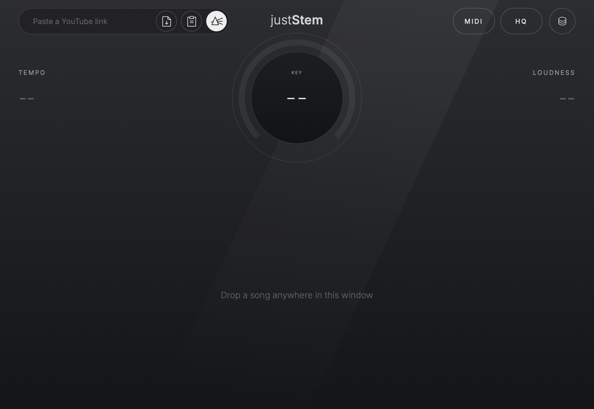

# justStem

justStem is an open-source VST3 / AU plug-in that splits a song into six stems,
**vocals, drums, bass, guitar, piano and other**, plus an instrumental and the full mix, finds its
**key, tempo, loudness and chords**, and can write the **vocals, bass, guitar, piano and other as MIDI**. Give it an audio file or a YouTube link; the AI runs on your
computer, and nothing is uploaded.

<p align="center"></p>

justStem is part of the **just** family with [justComp](https://github.com/PLATONG34821/justComp), an AI-assisted
compressor. In your DAW both are listed under **just**.

## Features

- 6 stems plus an instrumental and the full mix, kept as lossless 24-bit FLAC (half the size of WAV) that you can drag onto DAW tracks; **Save all** exports WAVs
- Key (with Camelot code), tempo and loudness (LUFS)
- Chords bar by bar, with a copyable chart
- MIDI of the vocals, bass, guitar, piano and other (with velocity; sustain pedal on the piano), at the song's tempo, to drag onto DAW tracks (turn on **MIDI**)
- Transpose ±11 semitones: chords, live preview and pitch-shifted stem and MIDI export
- Stem preview with mute / solo / volume, in sync with your DAW
- **HQ** mode (BS-RoFormer) for cleaner stems, slower than the standard model

| Start | Splitting | Chords |
|:---:|:---:|:---:|
|  |  |  |
| **New song** | **Storage** | **Stems** |
|  |  |  |

## Install

Download from [Releases](https://github.com/PLATONG34821/justStem/releases), then rescan plug-ins in your DAW:

- **macOS (installer, recommended):** open `justStem-<version>-macOS.pkg` to install the VST3 and AU plug-ins (and optionally the Standalone app), either for all users or for your account only. Because the installer isn't notarized yet, macOS will block it on first open—go to **System Settings → Privacy & Security** and click **Open Anyway**.
- **Manual install / Standalone (zips):** unzip and copy the plug-in (or run the standalone app) from the zip:

| | File | Copy to / run |
|---|---|---|
| **macOS** | `justStem.vst3` | `~/Library/Audio/Plug-Ins/VST3/` |
| | `justStem.component` (AU: Logic, GarageBand) | `~/Library/Audio/Plug-Ins/Components/` |
| | `justStem.app` (Standalone) | `/Applications/` |
| **Windows** | `justStem.vst3` | `C:\Program Files\Common Files\VST3\` |
| | `justStem/justStem.exe` (Standalone) | Unzip anywhere and run |
| **Linux** | `justStem.vst3` | `~/.vst3/` |
| | `justStem/justStem` (Standalone) | Unzip anywhere and run |

The standard AI model is built in so splitting works offline right away; the first time you turn on
**HQ** mode, `justStem` downloads the HQ model from GitHub Releases and verifies its SHA-256 checksum.
The MIDI model (59 MB) is downloaded the same way the first time **MIDI** is on; offline, that song
gets no MIDI (the stems are still made).

**Checking a download** (from 0.0.4): each release has a `SHA256SUMS` file. Download it next to the
installer or zip, then run `shasum -a 256 -c --ignore-missing SHA256SUMS` (macOS) or
`sha256sum -c --ignore-missing SHA256SUMS` (Linux); it should say `OK`. On Windows, compare
`(Get-FileHash <zip>).Hash` in PowerShell with the zip's line in the file.

**macOS (manual zip install only):** the builds aren't notarized yet, so run this once after copying:

```sh
xattr -dr com.apple.quarantine ~/Library/Audio/Plug-Ins/VST3/justStem.vst3 ~/Library/Audio/Plug-Ins/Components/justStem.component /Applications/justStem.app
```

**Updates:** from 0.0.3, justStem checks GitHub once a day for a newer release and tells you when
one is out. Only the latest version number is downloaded; nothing about you or your songs is sent.
To turn it off, set the environment variable `JUSTSTEM_NO_UPDATE_CHECK=1`.

## Supported and tested

| OS | Requirements | AI runs on | Tested |
|---|---|---|---|
| **macOS** | macOS 12+, Apple Silicon | GPU (CoreML) | Builds, automated tests, pluginval and auval on macOS 15 (CI); used in Waveform 14 on macOS 27 |
| **Windows** | Windows 10 1903+, x64 | GPU (DirectML) or CPU | Builds, automated tests and pluginval on Windows Server 2022 (CI) |
| **Linux** | x64, glibc | CPU | Builds, automated tests and pluginval on Ubuntu 24.04 (CI) |

Intel Macs aren't supported. Tried justStem in another DAW or OS? Please share how it went in
[Issues](https://github.com/PLATONG34821/justStem/issues).

## How to use

1. **Load a song** (up to 15 minutes): paste a YouTube link (use the **Paste** button if your DAW
   blocks ⌘V / Ctrl+V), click **Choose file**, or drop a file on the window. Turn on **MIDI** to also get the notes. Click **Split**.
2. **Stems:** mute, solo or set the volume of each stem; drag the ⠿ handle onto a DAW track, or
   the piano-keys handle beside it for the notes (MIDI). Turn on **Follow DAW** to play the stems with your DAW's transport.
3. **Chords:** shows the chord playing now and the next ones; click a bar to jump there.
4. **Transpose:** **−** / **+** moves the chords and preview; **Save all** exports shifted stems and MIDI.
5. **Storage** (top right): see and free the disk space justStem uses.

## Contributing

Bug reports, ideas and pull requests are welcome.

- **Report a bug:** open an [issue](https://github.com/PLATONG34821/justStem/issues) with your OS,
  DAW and justStem version (top right of **Storage**), what you did, and what happened (the log in
  the plug-in helps).
- **Change the code:** fork, make a branch, and open a pull request. Build and test it first:
  see [docs/DEVELOPMENT.md](docs/DEVELOPMENT.md) for building, tests and how the code is laid out.
  CI builds and tests every pull request on macOS, Windows and Linux.
- Keep pull requests focused on one change, and follow the style of the code around it.

## License

justStem is licensed under the GNU AGPL-3.0 (see `LICENSE`). Third-party licences are listed in
[docs/DEVELOPMENT.md](docs/DEVELOPMENT.md#third-party-licences). The HQ model's weights have no
stated licence; justStem treats them as CC-BY-NC-SA-4.0, so HQ mode is for non-commercial use only.
The MIDI model (Transkun) is MIT-licensed, but it was trained on a non-commercial dataset
(MAESTRO), so check that before using the MIDI commercially.

The song in the screenshots is a synthetic demo. Only process music you have the rights to use;
downloading from YouTube may break YouTube's terms of service.
