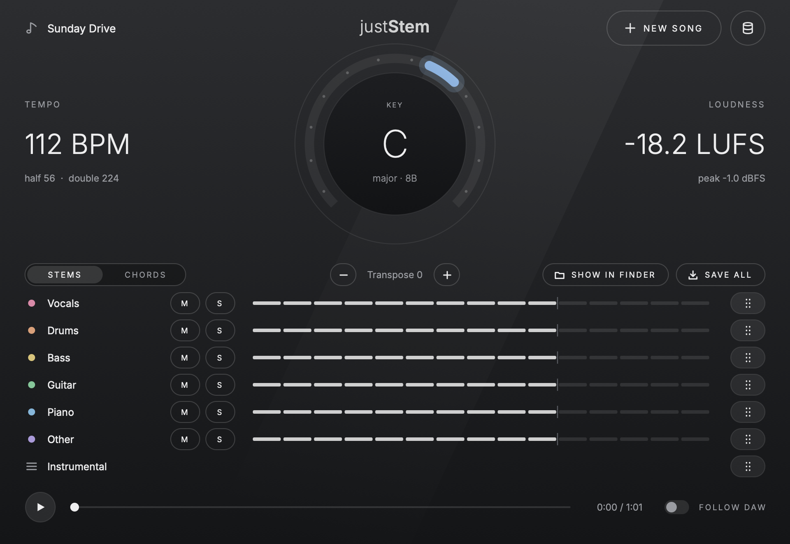
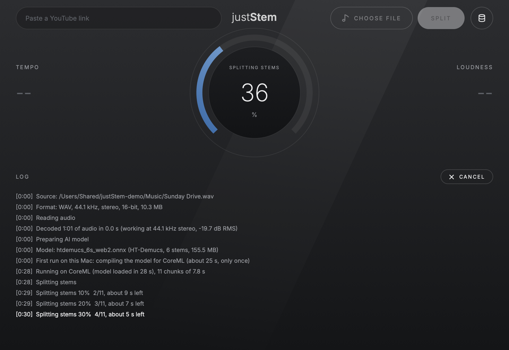
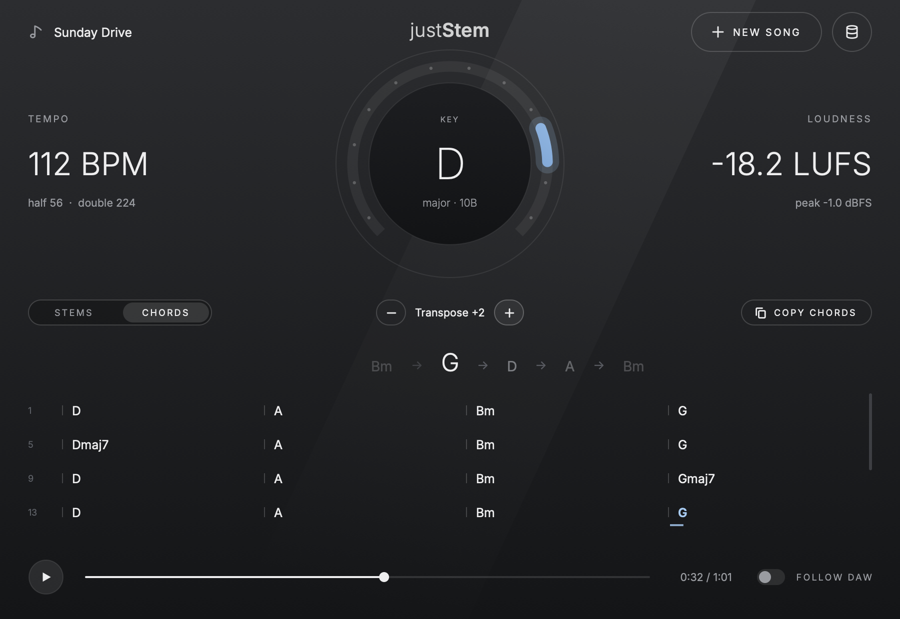

# justStem

A VST3 / AU plug-in (and standalone app) for people who make covers. Give it a song, as an audio
file or a YouTube link, and it:

- splits it into **vocals, drums, bass, guitar, piano and other**, plus an instrumental, saved as
  24-bit WAVs you can drag straight onto DAW tracks;
- finds the **key** (with Camelot code and tuning), **tempo** and **loudness** (LUFS);
- finds the **chords**, bar by bar, with a text chart to copy;
- **transposes** the chords, the stem preview (pitch-shifted live, same tempo, in time with your
  DAW) and, with Save all, a full set of pitch-shifted stems;
- previews the stems in sync with your session, with mute / solo / volume per stem.

Everything runs on your computer. The AI model (HT-Demucs, 6 stems) ships inside the plug-in.



| | Formats | AI runs on | Requirements |
|---|---|---|---|
| **macOS** | VST3, AU, standalone | GPU / Neural Engine (CoreML), CPU fallback | macOS 12+, Apple Silicon |
| **Windows** | VST3, standalone | GPU (DirectML: any DirectX 12 GPU), CPU fallback | Windows 10 1903+, x64 or ARM64 |
| **Linux** | VST3, standalone | CPU | x64 or ARM64, glibc |

Intel Macs aren't supported: Microsoft ships ONNX Runtime for macOS on Apple Silicon only.

## Install

Download the zip for your OS from [Releases](https://github.com/PLATONG34821/justStem/releases) and
copy the plug-in to your plug-in folder:

| OS | VST3 | AU |
|---|---|---|
| macOS | `~/Library/Audio/Plug-Ins/VST3/` | `~/Library/Audio/Plug-Ins/Components/` |
| Windows | `C:\Program Files\Common Files\VST3\` | |
| Linux | `~/.vst3/` | |

Then rescan plug-ins in your DAW. The standalone app runs without a DAW.

> **macOS:** release builds aren't notarized yet, so macOS blocks them at first. After copying,
> run this once in Terminal (it removes the "downloaded from the internet" flag):
> ```sh
> xattr -dr com.apple.quarantine ~/Library/Audio/Plug-Ins/VST3/justStem.vst3 ~/Library/Audio/Plug-Ins/Components/justStem.component
> ```

## Using it

### 1. Load a song

Paste a YouTube link (the **Paste** button helps in DAWs that keep ⌘V / Ctrl+V for themselves),
click **Choose file**, or drop an audio file anywhere on the window. Then click **Split**.


### 2. Splitting

The gauge shows progress and the log below it shows each step: the file's format, the AI model,
the GPU or CPU it runs on, time left, and afterwards the stem levels, key, tempo, loudness and
chords it found. **Cancel** stops it. A 5-minute song takes about 30 seconds on an M-series Mac;
the very first split on a Mac also compiles the model for CoreML (about 25 s, once).



### 3. Stems

The song's **tempo** (with half and double time, since the tempo octave is a guess), **key** and
**loudness** sit across the top. The key gauge lights the key's place on the Camelot wheel.

Each stem has **M**ute, **S**olo and a volume bar (double-click resets it to 100%). Drag the
⠿ handle onto a DAW track to drop that stem in. **Show in Finder** opens the song's folder and
**Save all** copies all the stems somewhere else.

The player at the bottom previews the stems. With **Follow DAW** on, they play along with your
DAW's transport instead; move the DAW's playhead to jump (a plug-in can't move the DAW's
playhead, so the seek bar only follows it).

### 4. Chords and transpose

The **Chords** tab shows the chord playing now, big and centred, with the one before and the next
three. The line slides along as the song plays. Below it, the song as bars (4 per row) follows
playback; click a bar to jump there. **Copy chords** copies a text chart.

**−** / **+** transposes by semitones (±11, saved with the DAW project). The chords, the key and
the stem preview all follow. With Transpose on, **Save all** writes a pitch-shifted set of stems
to a new folder; your original stems aren't changed. Shifts within ±3 semitones sound most
natural, especially on vocals.



### 5. Another song

**New song** brings the link box back (× or Esc returns to the open song). Every song you split
stays saved, and a DAW project reopens with its song.


### Storage

The ⛁ button (top right) shows what justStem keeps on disk and lets you free space: delete saved
songs (moved to the Trash after you confirm; the song open in the plug-in is kept), clear the
CoreML cache (rebuilt automatically, about 25 s, once), remove the YouTube tools (downloaded again
when needed) and clear temporary downloads. Nothing can be deleted while a song is being split.


## Where files go

| What | Where |
|---|---|
| Stems for each song (7 WAVs + `info.json`) | `<your Music folder>/justStem/<song title>/` |
| yt-dlp and Deno (downloaded on the first YouTube link) | `<app data>/justStem/bin/` |
| CoreML's compiled model (macOS; makes later loads fast) | `<app data>/justStem/coreml-cache/` |
| YouTube audio while it's being processed | `<app data>/justStem/downloads/` |

`<app data>` is `~/Library/Application Support` on macOS, `%APPDATA%` on Windows and `~/.config`
on Linux. A DAW project only stores the song folder's path and the mute / solo / volume /
transpose settings. Uninstalling the plug-in doesn't remove any of this; use **Storage**.

## Audio formats

WAV, AIFF, FLAC, Ogg Vorbis, MP3 and M4A (AAC-LC and HE-AAC, including YouTube's fragmented
files). The same decoders are used on every OS: JUCE's readers, plus our own MP4 reader with FAAD2
for AAC. Decoding is gapless: the encoder delay and padding recorded in the file (iTunes
`iTunSMPB`, MP4 edit lists, LAME / ffmpeg MP3 tags) are removed, so the stems line up
sample-exactly with the original file in a DAW.

## How chords are found

The chords come from the separated stems: guitar + piano + other for the harmony, the bass stem
for the bass note, and the drums for the beats. Vocals are left out (they carry the melody).

1. **Beats**: a dynamic-programming beat tracker follows the detected tempo through the drums.
2. **Per beat**: the strength of each of the 12 notes (chroma) in the chord instruments, and the
   lowest strong note in the bass.
3. **Matching**: major, minor, 7, maj7, m7, sus2, sus4 and dim on every root, in root position or
   with another chord tone in the bass (slash chords only when the bass clearly says so).
4. **Smoothing**: Viterbi decoding makes chords hold rather than flicker and leans towards chords
   in the song's key. A first pass finds which beat of four the chords change on (the bar line),
   and the second pass prefers changes there.

4/4 is assumed. Expect most chords right on pop and rock; dense or jazzy harmony is harder.

## Building

You need CMake ≥ 3.28, Ninja and a C++20 compiler: the Xcode command-line tools on macOS, Visual
Studio 2022 (run from a "Developer" command prompt) on Windows, GCC or Clang on Linux plus JUCE's
packages (see `.github/workflows/build.yml`). JUCE, ONNX Runtime and FAAD2 are downloaded by CMake
(pinned versions, checked against their SHA-256).

1. Build the model once (needs Python 3); see the top of `scripts/prepare_demucs_onnx.py`. The
   model isn't in git (`models/` is ignored), so every clone needs this step:
   ```sh
   python3 -m venv .venv && .venv/bin/pip install onnx onnxruntime numpy
   curl -L -o htdemucs_6s_fp16weights.onnx \
     https://huggingface.co/StemSplitio/htdemucs-6s-onnx/resolve/main/htdemucs_6s_fp16weights.onnx
   .venv/bin/python scripts/prepare_demucs_onnx.py htdemucs_6s_fp16weights.onnx models/htdemucs_6s_web2.onnx
   ```
2. Build:
   ```sh
   cmake -S . -B build -G Ninja -DCMAKE_BUILD_TYPE=Release
   cmake --build build
   ```
   The plug-ins are in `build/justStem_artefacts/Release/`, and are also installed for you:
   - **macOS:** VST3 and AU in `~/Library/Audio/Plug-Ins/`. Local builds are ad-hoc signed, so
     they run on the machine that built them.
   - **Linux:** VST3 in `~/.vst3/`.
   - **Windows:** copy `justStem.vst3` to `C:\Program Files\Common Files\VST3\` (needs admin rights).

Every push is built and tested on macOS, Windows and Linux by GitHub Actions
(`.github/workflows/build.yml`); the built plug-ins can be downloaded from each run.

## Testing

```sh
build/juststem_cli_artefacts/Release/juststem_cli analyze-selftest
build/juststem_cli_artefacts/Release/juststem_cli selftest models/htdemucs_6s_web2.onnx
build/juststem_uitest_artefacts/Release/juststem_uitest models/htdemucs_6s_web2.onnx <song> <screenshot folder>
```

- `analyze-selftest`: the resampler against exact sine waves and an aliasing test, loudness
  against the EBU reference signals, key detection in all 24 keys, tempo from 72 to 174 BPM,
  beats, bar lines and chords (7ths, sus, dim, slash chords) in a synthetic band recording in 4
  keys, and pitch shifting (pitch within 5 cents, no timing offset, same level).
- `selftest`: separates a synthetic track and scores each stem against the original parts.
- `juststem_uitest`: runs the real plug-in code without a DAW. It renders every screen to PNGs
  (the screenshots above come from it), splits a song, and checks the preview audio, New song and
  Paste, the Storage panel, the chord view, the transposed preview (in time with the original),
  transposed stem saving, and saving / reloading the plug-in state.

Set `JUSTSTEM_DATA_DIR` to an absolute folder to keep a run's songs and caches there instead of
in your Music folder and app data (useful for tests and screenshots).

`juststem_cli` can also `separate`, `analyze` or `import` real songs, or print the `chords` of a
song folder the plug-in saved; see the top of `tools/cli.cpp`.

## Code layout

```
src/core/      Separation and analysis. Plain C++ + ONNX Runtime, no JUCE.
  Audio.h        shared types: StereoAudio, Stem, sample rate
  Separator.*    runs HT-Demucs in crossfaded chunks (CoreML / DirectML / CPU)
  Analysis.*     key, tempo, loudness (EBU R128)
  Chords.*       beat tracking, bar lines and chord recognition
  Dsp.*          shared spectral peaks and onset envelope
  PitchShift.*   real-time and offline pitch shifting (Signalsmith Stretch)
  Resampler.*    sample-rate conversion to 44.1 kHz (polyphase, exact timing)
src/io/        Files and the outside world (JUCE).
  AudioFiles.*   decode audio files to 44.1 kHz stereo (gapless); write WAVs
  M4aDecoder.*   M4A / MP4 reader (classic and fragmented) + FAAD2 AAC decoding
  YouTube.*      download a video's audio with yt-dlp
  ToolInstaller.* download and verify yt-dlp and Deno
  AppPaths.h     where files are stored
src/plugin/    The plug-in.
  PluginProcessor.*  audio pass-through + stem preview, runs song jobs, saves state
  PluginEditor.*     the window
  SongJob.*          background work: import -> split -> analyse -> save, and its log
  SongResult.*       a split song; saves and reloads it
  StemPlayer.*       real-time stem preview (lock-free on the audio thread)
  ui/                theme (Inter font, colours, icons, buttons), widgets (key gauge, stem rows,
                     segmented tabs), the chord view and the Storage panel
tools/         Developer tools, not shipped (see Testing).
scripts/       Builds the model file.
resources/     Embedded fonts.
docs/          README screenshots.
cmake/         ONNX Runtime download (per OS), packaging.
.github/       CI: build + test on macOS, Windows and Linux.
```

## Licences

justStem is licensed under the GNU AGPL-3.0 (see `LICENSE`), as required by JUCE's free licence.

- [JUCE](https://juce.com): AGPL-3.0 / commercial
- [ONNX Runtime](https://github.com/microsoft/onnxruntime): MIT
- [Inter](https://rsms.me/inter/) font (UI typeface, embedded): SIL Open Font License 1.1, see `resources/fonts/OFL-LICENSE.txt`
- [Signalsmith Stretch](https://github.com/Signalsmith-Audio/signalsmith-stretch) and
  [Signalsmith Linear](https://github.com/Signalsmith-Audio/linear) (pitch shifting): MIT
- [FAAD2](https://github.com/knik0/faad2) (AAC decoder): GPL-2.0-or-later, used under GPL-3.0 with the AGPL
- [DirectML](https://github.com/microsoft/DirectML) (Windows builds only): Microsoft's proprietary,
  redistributable `DirectML.dll` (Microsoft Software License Terms). Check that bundling it suits
  how you distribute justStem.
- [HT-Demucs](https://github.com/facebookresearch/demucs) (Meta): MIT. ONNX export by
  [StemSplitio](https://huggingface.co/StemSplitio/htdemucs-6s-onnx) (MIT)
- [yt-dlp](https://github.com/yt-dlp/yt-dlp) (Unlicense) and [Deno](https://deno.com) (MIT),
  downloaded at runtime, not bundled

The song in the screenshots ("Sunday Drive") is a synthetic demo made for them. Only process music
you have the rights to use. Downloading from YouTube may break YouTube's terms of service.
